  
  SOFTWARE ENGINEERING · BACKEND · ALGORITHMS · GAME SYSTEMS
  
<a href="#about">About</a> · <a href="#projects">Projects</a> · <a href="#workshop">Workshop</a> · <a href="#toolbox">Toolbox</a> · <a href="#beyond-code">Beyond code</a>

---

### \`> whoami\`

I'm **Carlos Benedito Maciel II**, also known as **SkylerZ** — a Software Engineering student at **iCEV**, from Teresina, Brazil.

I love building things. What really keeps me interested, though, is understanding **how** they work. I don't want to stop at "this works"; I want to know *why* it works, what breaks it, and how I could build it differently.

I like hard problems, especially those that force me to question an old assumption. Most of my work lives somewhere between **backend development, algorithms, data structures, databases and game systems**.

I also write stories and design tabletop RPG worlds. I believe systems and stories are closer than they look: both need rules, consequences and room for the unexpected.

> *Criar uma história entre as linhas de código.*

### \`// selected_builds\`

A few repositories you can actually open and inspect:

| Build | What happens under the hood |
| :-- | :-- |
| **[Vortex — Recruitment](https://github.com/SkylerZdev/Recrutamento-Vortex)** · \`PHP / Laravel\` | Recruitment system with vacancies, candidates, applications, a JSON API and PostgreSQL. A technical challenge that pushed me into a new stack. |
| **[iCEVOS](https://github.com/SkylerZdev/iCEVOS)** · \`C\` | A process scheduler featuring priority queues, blocking/unblocking and anti-starvation. OS theory made executable. |
| **[Forensic Log Analyzer](https://github.com/SkylerZdev/analisador-de-logs)** · \`C / Algorithms\` | Detecting patterns and tracing events across logs with data structures and graph searches. |
| **[WorldTalk System](https://github.com/SkylerZdev/WorldTalk-System)** · \`Java\` | Collaborative academic system for language-school management, organized into independent responsibilities. |
| **[School Collections](https://github.com/SkylerZdev/java-colecoes-escolar)** · \`Java\` | \`ArrayList\`, \`Set\`, \`HashMap\`, CSV processing, sorting, reports and a lot of attention to data representation. |

Also in the archive: [Flyweight design pattern](https://github.com/SkylerZdev/TrabalhoFlyweight).

### \`// the_workshop\`

Not everything I build is public yet.

- **RPGine** · \`Next.js / TypeScript / .NET / PostgreSQL\` — An in-development platform for tabletop RPG characters and combat systems.
- **StudyNet** · \`C# / ASP.NET Core / EF Core / PostgreSQL\` — A backend project exploring CRUD, REST endpoints and deployment with Linux/Nginx.
- **Hex-grid tactical roguelike** · \`Luau / Roblox Studio\` — A prototype with modular grid movement, pathfinding and turn-based architecture.
- **MOPE** · \`Product / Leadership\` — A gamified productivity concept I **initiated, led and managed**, from team planning through the academic pitch.

### \`// toolbox\`

Tools matter. Knowing **when** and **why** to use them matters more.

| Branch | Loadout |
| :-- | :-- |
| **Languages** | \`C#\` · \`Java\` · \`C\` · \`SQL\` · \`Luau\` |
| **Backend / data** | \`ASP.NET Core\` · \`.NET\` · \`Entity Framework Core\` · \`PostgreSQL\` · \`REST APIs\` |
| **Web** | \`TypeScript\` · \`React\` · \`Next.js\` · \`PHP / Laravel (learning)\` |
| **Algorithms** | \`BFS\` · \`DFS\` · \`UCS\` · \`A*\` · \`AVL\` · \`Red-Black Trees\` |
| **Workflow** | \`Git\` · \`GitHub\` · \`VS Code\` · \`Debugging\` · \`Documentation\` · \`Linux\` |

Different levels of experience across these tools — this is a map of what I've worked with and studied, not a list of things I've mastered.

### \`// beyond_code\`

**Away from the keyboard:** writing fiction, worldbuilding, running RPG campaigns and playing games that give me more ideas than spare time.

**Languages:** Portuguese (native), English (fluent), Japanese (learning).

**Long-term quest:** create software people use, games people remember, and stories worth telling.

  <a href="https://github.com/SkylerZdev">GitHub</a> · <a href="https://www.linkedin.com/in/carlos-maciel-563a21307/">LinkedIn</a>
    
  <i>Se for muito difícil, deixa comigo. Se for impossível, me dá mais cinco minutos.</i>

